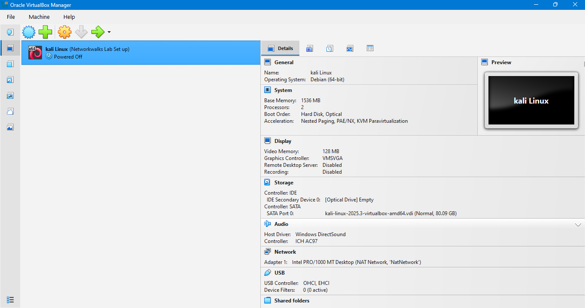
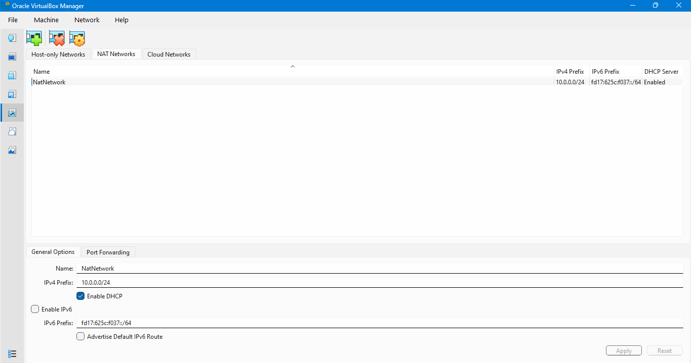
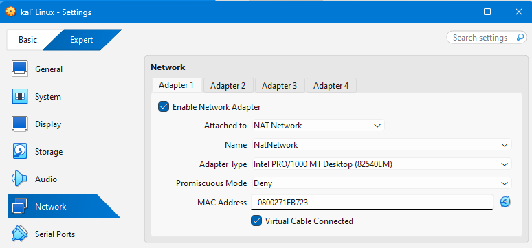
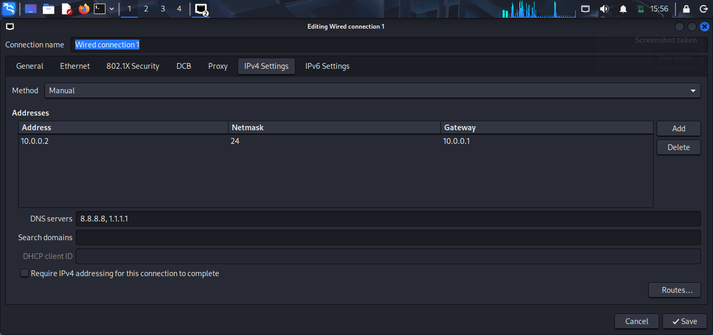
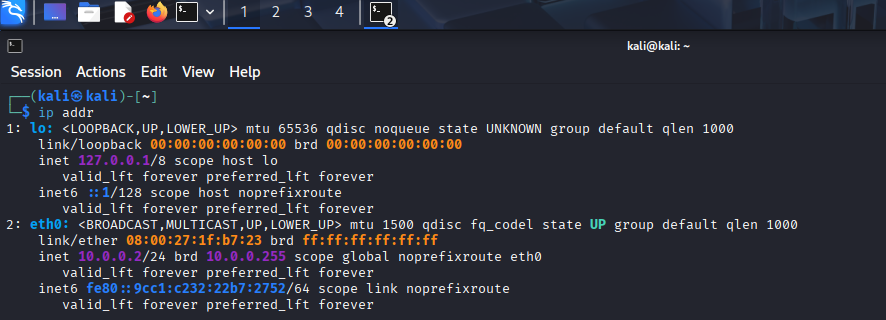
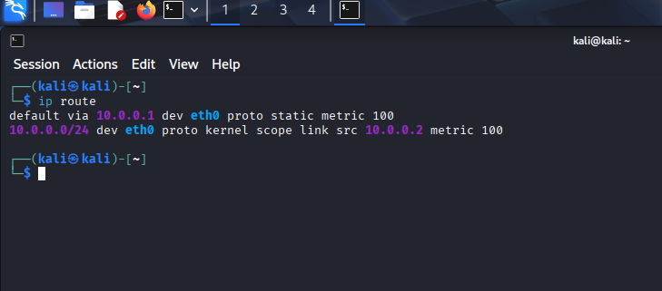
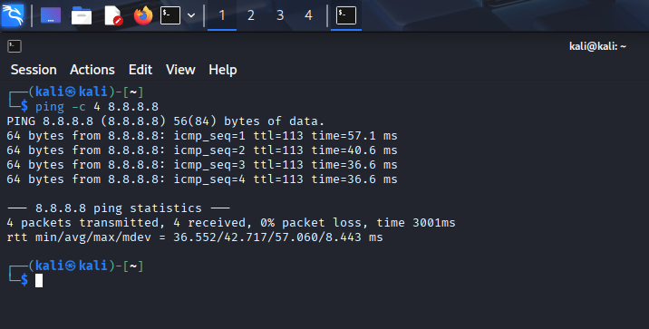
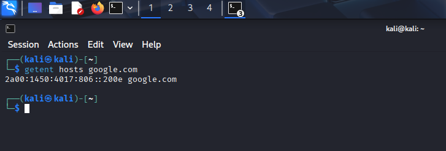
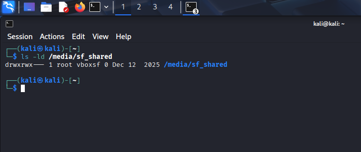
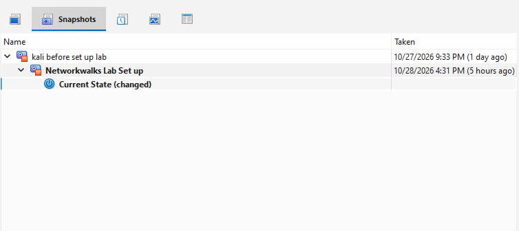

# NETWORKWALKS-ABUUBAKAR-B084-WK1-PM1-CYBERSECURITY-LAB-SETUP

Hands-on cybersecurity lab setup using Kali Linux and VirtualBox, covering virtual machine configuration, NAT Network setup, IP addressing, network connectivity testing, and practical documentation with screenshots.

# Cybersecurity Lab Setup – Kali Linux & VirtualBox

## 1. VirtualBox Configuration

Oracle VirtualBox was downloaded and installed, and the Extension Pack was prepared. Kali Linux was also installed and configured as a virtual machine.

**Objective:** Prepare the virtual environment for network configuration and connectivity testing.



---

## 2. NAT Network Settings

A NAT Network was configured with the following settings:

- **Network:** NAT Network
- **Subnet:** `10.0.0.0/24`
- **Gateway:** `10.0.0.1`
- **DHCP:** Configured according to the lab setup.

**Objective:** Provide Kali Linux with network connectivity and internet access through VirtualBox.



---

## 3. Kali Linux Network Adapter

The Kali Linux network adapter was connected to the configured NAT Network, and **Cable Connected** was enabled.

**Result:** The virtual network adapter was enabled and ready for network communication.



---

## 4. Static IP Configuration

The network settings were configured manually in Kali Linux under **Edit Connections**.

| Setting | Value |
|---|---|
| IPv4 Address | `10.0.0.2` |
| Netmask / Prefix | `/24` (`255.255.255.0`) |
| Gateway | `10.0.0.1` |
| DNS Servers | `8.8.8.8`, `1.1.1.1` |

**Result:** Kali Linux was configured with the intended static IP address, default gateway, and DNS servers.



---

## 5. Network Verification and Testing

The following commands were executed to verify the network configuration and connectivity.

### A. Check IP Address

**Command:**

```bash
ip addr
```
**Observed result:** The `eth0` interface was UP and had the IP address `10.0.0.2/24`.

**Conclusion:** The network interface was active and had the expected IP configuration.



---

### B. Check Routing Table

**Command:**

```bash
ip route
```
**Observed result:**

- Default gateway: `10.0.0.1`
- Local network: `10.0.0.0/24`
- Source IP: `10.0.0.2`

**Conclusion:** The routing table contained the expected local route and default gateway.



---

### C. Test Internet Connectivity

**Command:**

```bash
ping -c 4 8.8.8.8
```
**Observed result:** Four packets were transmitted and received, with `0% packet loss`.

**Conclusion:** Kali Linux successfully communicated with the external IP address, confirming internet connectivity through IP communication.



---

### D. Test DNS Resolution

**Command:**

```bash
getent hosts google.com
```

**Observed result:** The command returned an IPv6 address for `google.com`.

**Conclusion:** DNS name resolution was working because the domain name was successfully resolved to an IP address.



---

### Overall Network Verification

All four tests produced the expected results. The network interface, IP addressing, routing, internet connectivity, and DNS resolution were functioning correctly.

---

## 6. Shared Folder Verification

The following command was used to check the VirtualBox shared folder:

```bash
ls -ld /media/sf_shared
```
**Observed result:** The `/media/sf_shared` directory existed and was associated with the `vboxsf` group.

**Conclusion:** The shared folder mount point was present in Kali Linux. Actual read and write access depends on folder permissions and user group membership.



---

## 7. Virtual Machine Snapshot

A VirtualBox snapshot was taken after completing the configuration and verification steps.

**Purpose:** The snapshot provides a restore point, allowing the virtual machine to return to this working state if future experiments or configuration changes cause problems.



---

## 8. Troubleshooting: Network Connection Issue

During the setup, a network connection issue occurred in Kali Linux 2025, even though the network settings appeared correct.

The issue was addressed using the following commands:

```bash
sudo nmcli connection modify "Wired connection 1" ipv4.dad-timeout 0
sudo nmcli connection down "Wired connection 1"
sudo nmcli connection up "Wired connection 1"
```
### Explanation

- `ipv4.dad-timeout 0` changes the IPv4 Duplicate Address Detection (DAD) timeout setting.
- The second command disconnects the network connection.
- The third command reconnects the network so the updated settings can take effect.

**Possible Cause:** The issue may have been related to IPv4 duplicate-address detection or the network connection activation process. However, the exact cause cannot be confirmed from these commands alone.

**Outcome:** The commands were used to address the connection issue, and network connectivity was subsequently tested.

---

## 9. Final Conclusion

The Kali Linux virtual machine was configured on VirtualBox using a NAT Network with a static IP address. Network interfaces, routing, internet connectivity, DNS resolution, and the shared folder mount point were verified.

A snapshot was created to preserve the working configuration, and a network connection issue encountered during setup was addressed.

This lab demonstrates basic virtual networking, IP configuration, connectivity troubleshooting, and practical network verification using Kali Linux.

